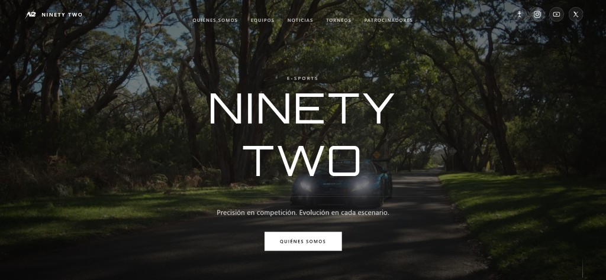
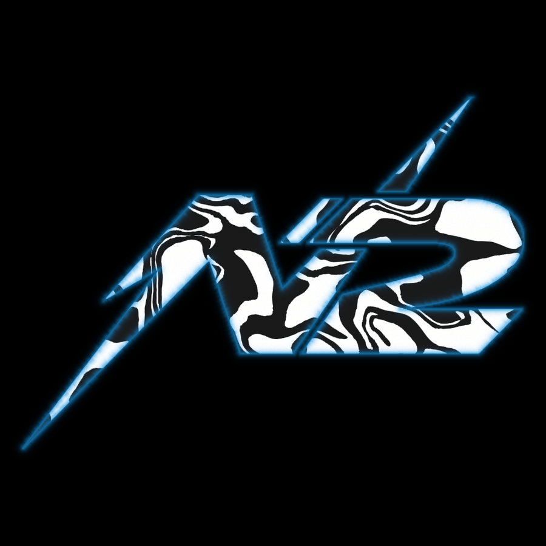

# Ninety Two E-Sports

Web oficial de **Ninety Two E-Sports**, un club de sim racing que compite en Gran Turismo, Le Mans Ultimate e iRacing.

**En producción:** [ninetytwoesports.com](https://www.ninetytwoesports.com) · **Código:** [github.com/JuxnFoAI/ninety-two-e-sports](https://github.com/JuxnFoAI/ninety-two-e-sports)

### En 30 segundos

- Sitio publicado para un club real de sim racing, con rutas propias y animaciones a medida.
- Documentación del _por qué_ (`DECISIONS.md`) y del _cómo_ (`CONVENTIONS.md`), no solo el código.
- Cada cambio pasa por CI (formato, lint, tipos, tests y build) antes de desplegar en Vercel.



## El proyecto

El club necesitaba un sitio que se sintiera a la altura de su nivel competitivo: presentar a sus pilotos, contar su historia, mostrar sus diseños de coches y seguir sus torneos, sin depender de redes sociales para todo.

El resultado es una web que se recorre como una historia. La primera pantalla es el logo **N2**: la tinta se mueve dentro de la silueta del isotipo y, con un barrido, queda la marca en blanco sólido. A partir de ahí vienen quiénes somos, los diseños del equipo y los patrocinadores. Además tiene páginas propias para equipos, noticias y torneos.

| Sección  | Qué encuentra el visitante                                                           |
| -------- | ------------------------------------------------------------------------------------ |
| Inicio   | La historia del club, su cambio de marca, los diseños de los coches y patrocinadores |
| Equipos  | Las divisiones del club con la ficha de cada piloto y sus redes                      |
| Noticias | Fichajes y resultados en un carrusel de tarjetas que se abre en detalle              |
| Torneos  | La última carrera como si fuera una retransmisión, con el calendario de la temporada |
| Fotos    | Galería completa de los diseños, con descarga en alta calidad                        |



## Lo que hay detrás

Una web bonita no basta si no la puede usar todo el mundo o si va lenta en el móvil. Estas fueron las prioridades:

**Accesible para todos.** El sitio tiene un panel de accesibilidad propio con 13 opciones agrupadas por necesidad: visual, daltonismo, auditiva, motora y cognitiva. Incluye filtros para tres tipos de daltonismo, contraste reforzado, modo lectura, tipografía legible y la opción de reducir el movimiento. Las preferencias se recuerdan entre visitas y cada animación del sitio las respeta.

**Rápido y adaptado a cada dispositivo.** Cada página descarga solo lo que necesita y las imágenes se sirven al tamaño en que se ven. La intro del logo es la versión más rica en equipos capaces; en teléfonos modestos, con datos ahorrados o si alguien pide menos movimiento, entra una variante más ligera sin romper la experiencia. Si el motor gráfico falla, el sitio sigue con un plan B. Hay pruebas de carga propias para ver cómo responde cuando suben las visitas.

**Cuidado en los detalles.** Cada sección tiene su propia entrada animada (títulos que chocan, se barren o se revelan con el scroll), pensada para contar algo sobre el club y no solo para decorar. La marca no se limita al header: empieza en la pantalla de carga.

**Calidad que no depende de la memoria.** Cada cambio pasa por una revisión automática antes de publicarse: formato, errores comunes, tipos, pruebas unitarias en lógica sensible (accesibilidad, detección de dispositivo) y compilación. Si algo falla, no llega a producción.

**Decisiones explicadas.** El repositorio documenta no solo cómo está hecho, sino por qué se eligió cada camino y qué alternativas se descartaron:

- [`docs/DECISIONS.md`](docs/DECISIONS.md): el porqué de cada decisión de diseño y de infraestructura.
- [`docs/CONVENTIONS.md`](docs/CONVENTIONS.md): cómo está organizado el código para que otra persona pueda continuarlo.

## Tecnologías

| Para qué    | Con qué                                                                                     |
| ----------- | ------------------------------------------------------------------------------------------- |
| Interfaz    | React 18 y TypeScript                                                                       |
| Estilos     | Tailwind CSS y CSS Modules                                                                  |
| Animaciones | CSS, Motion y GSAP según el gesto; intro de marca en WebGL cuando el dispositivo lo permite |
| Compilación | Vite                                                                                        |
| Calidad     | ESLint, Prettier, Vitest y GitHub Actions en cada cambio                                    |
| Rendimiento | Grafana k6 para pruebas de carga                                                            |
| Publicación | Vercel, con despliegue automático desde `main`                                              |

Es un sitio estático: no tiene servidor propio ni base de datos, porque el contenido no lo necesita. Eso lo hace más barato, más rápido y con menos puntos de fallo.

## Autor

Diseñado y desarrollado de punta a punta por **Juan José Vargas** ([@JuxnFoAI](https://github.com/JuxnFoAI) · [repositorio](https://github.com/JuxnFoAI/ninety-two-e-sports)): producto en producción, documentación de decisiones y pipeline de calidad incluidos.

---

## Guía para quien mantiene el sitio

### Arrancar en local

Hace falta [Node.js 20](https://nodejs.org/) o más (npm viene con Node).

```bash
npm install
npm run dev
```

Abre [http://localhost:5173](http://localhost:5173). Es Vite: no uses Live Server ni abras `index.html` a mano.

Si no ves el cambio: para el servidor (`Ctrl+C`), `npm run dev:clean` y recarga forzada (`Ctrl+Shift+R`). `dist/` solo se genera con `npm run build`; no edites ahí.

### Dónde va cada cosa

| Qué                                  | Dónde                                                                                           |
| ------------------------------------ | ----------------------------------------------------------------------------------------------- |
| Fotos de pilotos, noticias, sponsors | `assets/…` y un `import` en el TypeScript que las usa                                           |
| Diseños / liveries                   | `assets/Designs/` + una entrada en `TEAM_DESIGNS` (`src/features/landing-page/data/designs.ts`) |
| Favicon o URL fija                   | `public/`                                                                                       |

Nombres en minúsculas con guiones (`bmw-frontal.jpg`). El original de Gran Turismo 7 va a 3840×2160; lo que se pega en el chat baja a 1024 y no vale para publicar. Antes de dejar una foto en el repo, `node scripts/optimize-web-images.mjs`.

El código está por pantallas en `src/features/`. La intro WebGL vive en `loading-screen/sculpt/`; la variante clásica, en `loading-screen/animation/`. `/fotos` no está en el menú (solo URL directa); en inicio los diseños están en `#disenos`.

### Subir un cambio

```bash
git status
git add assets/Designs/ src/features/landing-page/data/designs.ts
git commit -m "Se agregan nuevos diseños"
git push
```

Ajusta las rutas al archivo que hayas tocado. No subas `node_modules/`, `dist/` ni `.env`. En cada push, GitHub Actions corre formato, lint, tipos, tests y build. Vercel publica desde `main`.

### Otros comandos

| Comando                           | Qué hace                                                                  |
| --------------------------------- | ------------------------------------------------------------------------- |
| `npm run ci`                      | La misma revisión que corre GitHub Actions; pásala antes de subir         |
| `npm run build`                   | Deja la web lista en `dist/`                                              |
| `npm run preview`                 | Sirve esa build para probarla                                             |
| `npm run tournaments:sync-titles` | Actualiza los títulos de YouTube de los torneos                           |
| `npm run perf`                    | Construye, sirve la build en `http://127.0.0.1:4173` y lanza la prueba k6 |

Para `npm run perf` hace falta tener k6 (`winget install GrafanaLabs.k6`). El informe queda en `k6/results/informe.txt`. Mide la entrega de archivos en local; no toca la web publicada.

## Licencia

[MIT](LICENSE) © 2026 Juan José Vargas
